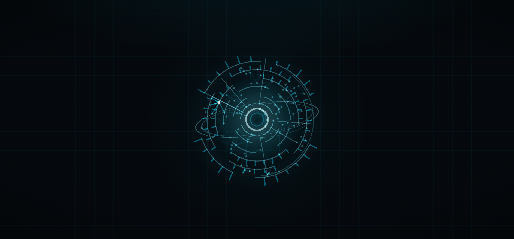
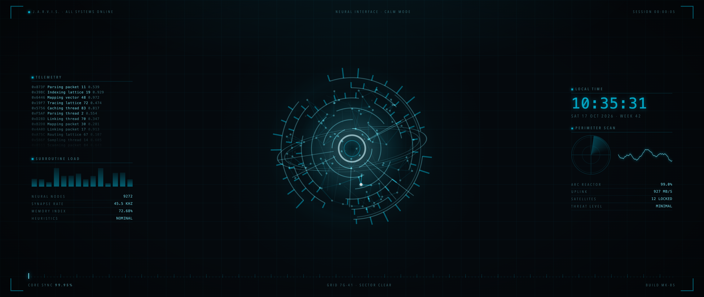

# Desktop Jarvis HUD

Moving desktop backgrounds for macOS, inspired by the holographic Jarvis in the Iron Man and Avengers films. A calm Jarvis hologram on a near-black HUD grid: rings of broken arcs turn slowly around an eye whose pupil breathes, filaments crackle softly, and now and then a lone thought fires through a network of neurons.

Want the same look elsewhere? Try [Obsidian Jarvis HUD](https://github.com/andyjohansson/obsidian-jarvis-hud) for your notes, [Terminal Jarvis HUD](https://github.com/andyjohansson/terminal-jarvis-hud) for macOS Terminal and [Claude Code Jarvis HUD](https://github.com/andyjohansson/claude-code-jarvis-hud) for Claude Code.



## What's included

| Background | File | What it is |
|---|---|---|
| Calm Jarvis | `wallpapers/jarvis-calm.html` | The Jarvis hologram, slow and quiet, with the occasional thought |
| Ultrawide Jarvis | `wallpapers/jarvis-21x9.html` | For 21:9 ultrawide screens, such as 2560 × 1080, 3440 × 1440, 3840 × 1600 and 5120 × 2160. A calm Jarvis in the middle and quiet HUD panels on the sides with telemetry, meters, a clock with date and week number, a radar sweep and a waveform |



The ultrawide layout scales with the screen size, so it fits any 21:9 resolution. The telemetry and readings in its panels are decoration. The clock is real.

Each background is a single HTML file with no dependencies and nothing loaded from the internet.

## Installation

macOS has no built-in way to use your own moving wallpaper, so it needs an app that shows a web page as the desktop background. [Plash](https://sindresorhus.com/plash) is free on the Mac App Store and works well.

1. Download or clone this repo.
2. Install Plash and open it from the menu bar.
3. Add a website in Plash with the file's address, for example:

   ```
   file:///Users/you/Dev/desktop-jarvis-hud/wallpapers/jarvis-calm.html
   ```

## Settings

Add settings to the end of the address, for example `jarvis-calm.html?x=72&size=70`. All are optional.

Calm Jarvis:

| Setting | Default | What it does |
|---|---|---|
| `x`, `y` | `50` | Where Jarvis sits, in percent of the screen. `x=72` moves it to the right, clear of your windows |
| `size` | `62` | How big, in percent of the screen height |
| `fps` | `30` | Frame rate cap. Lower saves power, `20` still looks smooth |

Ultrawide Jarvis:

| Setting | Default | What it does |
|---|---|---|
| `size` | `66` | How big Jarvis is, in percent of the screen height |
| `panels` | `1` | `panels=0` hides the side panels and keeps only Jarvis |
| `fps` | `30` | Frame rate cap. Lower saves power |

The background draws continuously, so it uses some GPU and battery. With **Reduce motion** turned on in macOS it shows a still frame instead.

## How it is built

The hologram is the same one the [Jarvis HUD FX](https://github.com/andyjohansson/obsidian-jarvis-hud#optional-jarvis-hud-fx-plugin) Obsidian plugin draws on Claudian's welcome screen and while Claude works. Instead of keeping a copy, `build.mjs` takes the engine from the plugin and puts it into each page in `templates/`, writing the result to `wallpapers/`. A change to the hologram reaches the desktop with one rebuild.

The built files are committed, so you only need this to change something:

1. Clone [obsidian-jarvis-hud](https://github.com/andyjohansson/obsidian-jarvis-hud) next to this repo, so both sit in the same folder.
2. Edit a template in `templates/`, or the engine between the `@mind-engine` markers in the plugin's `plugin/main.js`.
3. Run `node build.mjs`.

If the plugin repo is somewhere else, point `JARVIS_ENGINE` at its `plugin/main.js`.

## Files

| File | Purpose |
|---|---|
| `wallpapers/` | The ready-to-use backgrounds |
| `templates/` | The pages the backgrounds are built from |
| `build.mjs` | Builds `wallpapers/` from `templates/` and the plugin's engine |
| `screenshots/` | Images for this README |

## License

MIT
